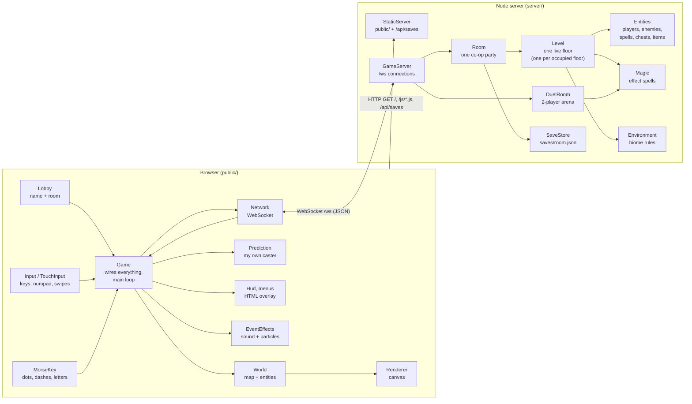
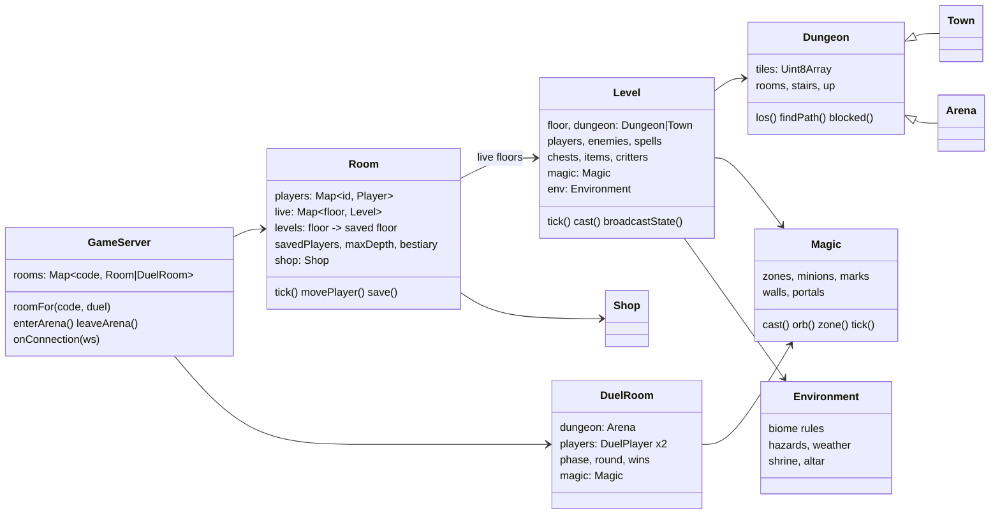
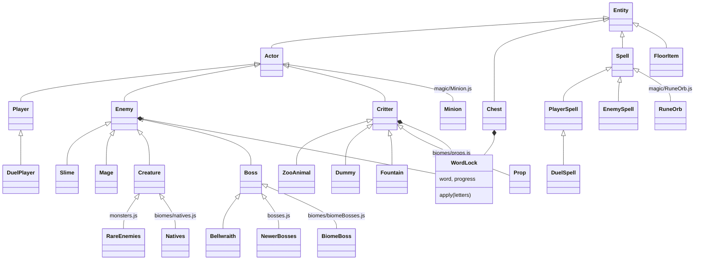
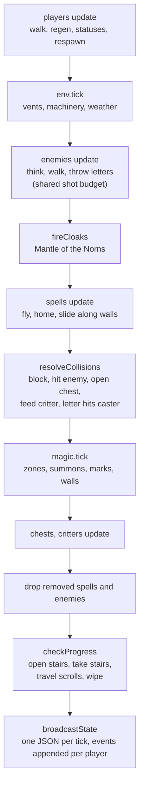
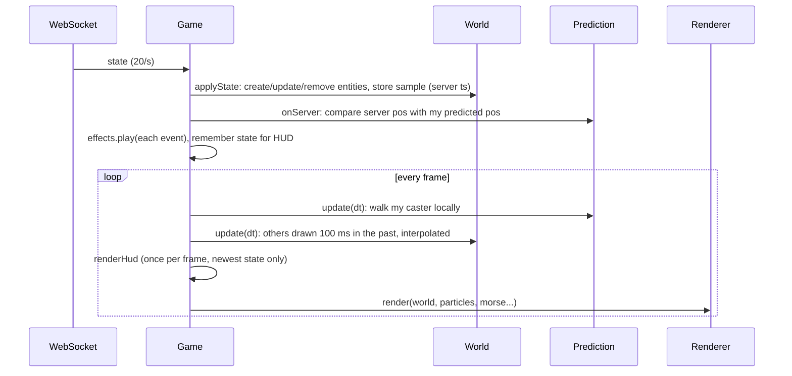
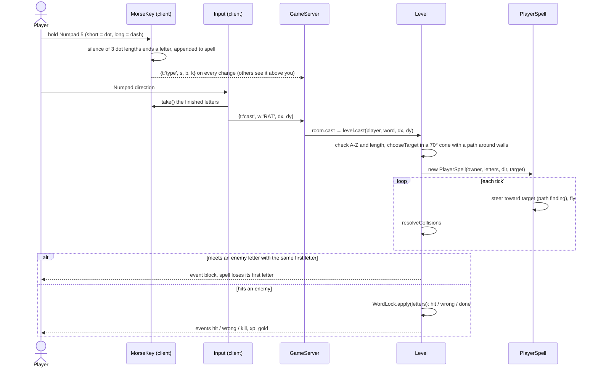
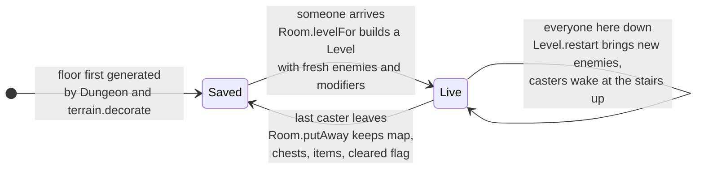
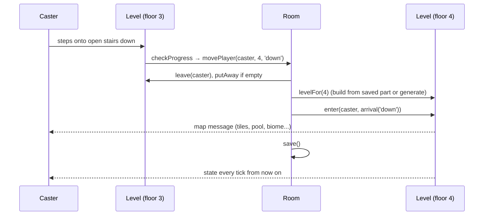
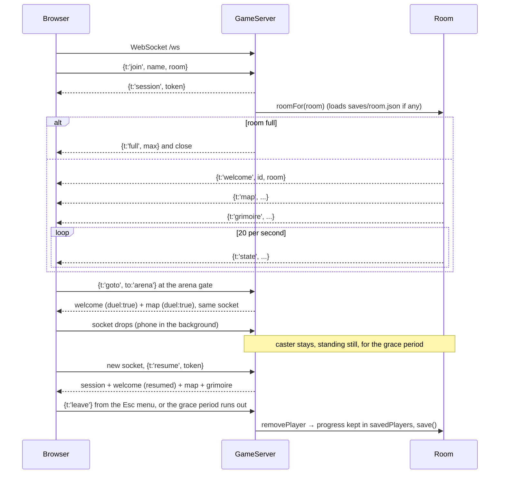

# Architecture

Spell Casters is one Node process that does two jobs: it serves the browser client as static files, and it runs
every game room over a single WebSocket endpoint (`/ws`). Browsers connect, join a room by name, and from then on
send input and receive a snapshot of their floor 20 times a second.

## The whole system

## Server object model

A **Room** is a party (up to 4 casters who joined with the same room name). Casters explore floors on their own,
so the Room keeps one running **Level** per floor that has at least one caster on it (`room.live`), and keeps the
persistent part of every other visited floor in `room.levels`. Entities get their Level as `room`: everything an
enemy, spell or item needs (map, enemies, spells, players on this floor) is reached through it.

The **DuelRoom** is a separate, Level-like room with the same tick/broadcast shape, reached from the arena gate on
the surface. Each co-op room has its own arena under the key `duel:<code>`.

### Entity class tree (server and client mirror each other)

`WordLock` is the "spell this word" rule shared by enemies, chests, critters and props. On the client,
`public/js/entities.js` has `Entity → Character → Player / Enemy (Slime, Mage, Creature, Boss) / Critter / Minion`,
plus `Chest`, `Spell` and `FloorItem`; each one holds the newest server snapshot in `data` and draws itself.

## One server tick (every 50 ms)

`Room.tick()` runs `Level.tick(now)` for every live floor. A tick is strictly ordered:

Effects that clients should see or hear (a block, a hit, gold, a level up) are pushed with `level.emit({ t, ... })`
during the tick and sent as the `ev` list of that tick's `state` message.

## Client frame

The client runs on `requestAnimationFrame`. Network messages are handled as they arrive; drawing happens once per frame.

## The life of a letter spell

Effect spells take the same road: the typed word starts with the rune `*` (Morse `..--`), and `Level.cast` hands
it to `Magic.cast`, which checks the grimoire, level, cooldown and mana, then runs the spell's function from
`server/magic/casts/`. Many of those throw a `RuneOrb`, a spell that carries the word and runs `land()` where it stops.

## A caster moving between floors

Stairs and travel scrolls move only the caster who uses them. Floors nobody stands on are put away.

## Connection lifecycle

## Where to go next

- [Code map](code-map.md) for what each file holds.
- [Network protocol](network-protocol.md) for every message and field.
- [Game systems](game-systems.md) for the rules in code.
