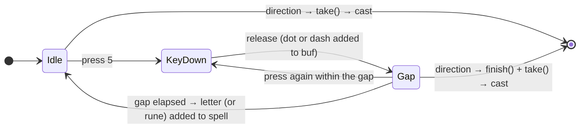
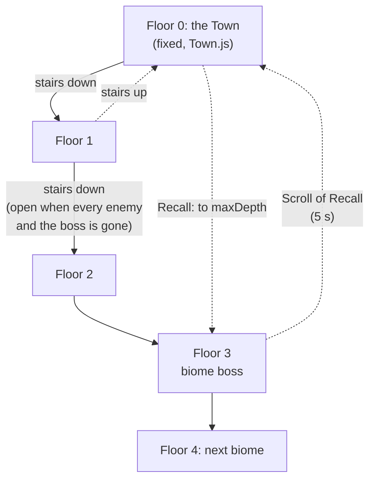
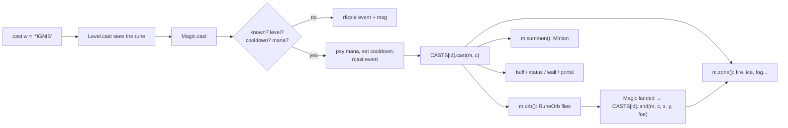
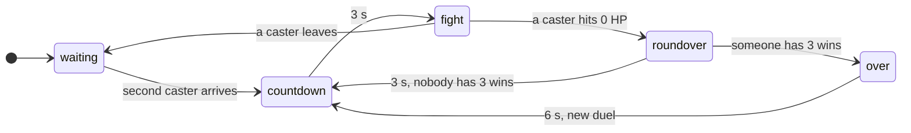

# Game systems

How the rules from the player's [README](../README.md) are implemented. File references are relative to the repo root.

## Morse input (client)

`public/js/morse.js` (`MorseKey`), fed by `public/js/input.js` and `public/js/touch.js`.

| Rule | Code |
| --- | --- |
| Dot length | `unit = 1200 / wpm` ms (PARIS standard). Default 7 WPM ≈ 171 ms |
| Dot or dash | A press shorter than `2 × unit` is a dot, longer is a dash. Numpad 0 adds a dash at once (`dash()`) |
| End of a letter | `gapUnits × unit` of silence (default 3) runs `finish()`. Pressing a direction also finishes the letter |
| Bad code | More than 5 symbols, or no such letter: dropped (`bad` is shown briefly), the spell so far is kept |
| The rune | `..--` as the *first* code becomes `*`: the spell is an effect spell. It does not count toward the letter limit |
| Spell length | `maxLen` (8, raised by some gear: the server sends `stats.letters`) |
| Cast | A numpad direction → `take()` returns the spell, `Network.cast(word, dx, dy)` sends it. If a spellbook puzzle is open, the letters are the answer instead |

Every change also goes out as a `type` message so the others see your letters above your wizard.

## Word locks

Every target you spell (enemy, chest, critter, prop, some summons in duels) has a `WordLock` (`server/entities.js`):
`word`, `progress` (letters already removed) and `next` (the letter that is needed now).

`apply(letters)` counts how many letters of the spell match the word from `progress` on:

- 0 matching: `'wrong'` (the target shakes, nothing is removed).
- some: `progress += k`, `'hit'`, or `'done'` if the word is finished. `used = k` lets Gungnir send the rest on.

So `RAD` on `RAT` removes `RA` and leaves `T`. Enemies route this through `hitBy(room, spell)`, which rare enemies
and bosses override (a Keyshell wants its key letter first, a Phantom is intangible, a Hydra's body is guarded...).
They can return extra results such as `'phase'` (a boss moving to its next name).

## Soft aim and homing

`Level.chooseTarget(pl, letter, dx, dy, taken)` picks what a new spell flies at:

1. Candidates whose *next letter* is the spell's first letter: enemy letters in the air (`proj`), enemies, chests,
   critters. Already claimed targets (`taken`, for multi-spell casts) are skipped.
2. Within `SPELL.homingRange × reach` tiles and a 70° cone around the direction (any direction with the Bow of Artemis).
3. Reachable: line of sight, or a path around walls (`Dungeon.findPath`, 8-way BFS, no corner cutting) no longer
   than `SPELL.homingPath × reach`.
4. Lowest score wins: `travel distance × (2 − cos angle) × kind weight` (enemy letters 0.7, enemies 1, chests and critters 1.3).

`PlayerSpell.steer` then turns toward the target at `SPELL.turnRate`, following the path when there is no line of
sight (re-planned every 0.25 s) and sliding along walls instead of breaking. Close to the target it turns straight at it.
A spell with no target flies straight and fizzles on a wall.

## Collisions and blocking (dungeon)

`Level.resolveCollisions` runs once per tick, in this order:

1. **Player spell vs enemy letter** (`HITBOX.block`): if the spell's first letter equals the enemy letter, both
   lose that letter; the rest of the spell flies on. Kusanagi cuts any letter for free.
2. **Player spell vs enemy** (`enemy.hitRadius`): `hitBy` → `afterEnemyHit` (XP and gold on `'done'`, item effects:
   stagger, burn, echo, thunderclap, chain, pierce, Draupnir).
3. **Player spell vs chest** (`HITBOX.chest`): opening spills loot on the floor.
4. **Player spell vs critter / prop**.
5. **Enemy letter vs caster** (`HITBOX.caster`): `Player.takeHit` (shield block letters, ward, reflect, pelt,
   armour, floor `hurtMult`, then HP; 0 HP = down for `PLAYER.respawnSeconds`).

Effect spell orbs (`RuneOrb`, which have `rune` set) skip steps 1 to 4; `Magic` lands them itself.

## Enemies

- **Spawning** (`server/spawner.js`): `3 + 2 × floor` enemies, at most `DEPTH.maxEnemies` (24). First the rare
  ones (`kind: 'special'`), then about 30% biome natives, then the everyday crowd, each picked by `weight`
  times the biome's `favor`. A floor that has not been cleared gets a boss in its last room (`spawnBoss`). Its
  words come from `wordFor`: a single letter or a word, longer deeper down, shifted by floor modifiers.
- **Behaviour** (`Enemy.update` in `server/entities.js`): sleep until a caster is in sight, then walk by the
  bestiary's `move` style and keep `dist` tiles away, throw letters every `fire` seconds in the `shot` pattern.
- **Shot budget**: the whole floor may have only `alive casters + min(floor / 2, 6)` enemy letters in the air at
  once (`shots.left` in `Level.tick`), so a deep floor is busy but readable.
- **Damage** (`server/progression.js`): `letterDamage = dmg × (1 + 0.25 × (floor − 1))`, rolled ×0.75..1.25,
  then `× 100 / (100 + armor)`.
- Hooks for special behaviour: `think`, `wake`, `hitBy`, `moveVector`, `attack`, `onDefeated`, `onLetterHit`,
  `onBlocked`, `label` (extra snapshot fields the client draws).

## Levels, HP, XP and gold

`server/progression.js` and `LEVELS` in `server/config.js`. XP for a word is the sum of its letter values (tier
1 to 4: `ETANIM` = 1 ... `BCJPQVXYZ` = 4) times the bestiary's `xp` multiplier; chests give half. Level L needs
`10 × L^1.5` XP to go up, max 30. HP = `20 + 6 × (L − 1)` plus gear. Natural regen starts 10 s after the last hit.
Gold goes straight to whoever finished the word (`Level.giveGold`, × the floor's `goldMult`).

## Floors

- **Persistence** (`Room.levels`): a floor keeps its layout, chests and items forever. Enemies are not kept when
  a floor is put away; it gets new ones when someone arrives on an empty floor. A cleared floor stays cleared
  (stairs open, no boss). Saved enemies only come back once, when a lobby is loaded from disk mid-fight.
- **Independent exploration**: `Room.movePlayer` moves only the caster who took the stairs or read the scroll.
  Arrival is beside the stairs leading back (`Level.arrival`), so you never bounce straight back. Stairs trigger on
  *stepping onto* them (`Player.onStairs`); sealed stairs say so once.
- **Wipes** are per floor: when everyone on a floor is down for 3 s, `Level.restart` brings new enemies (and the
  boss if it lives) and puts the casters at the stairs up at half HP. Single downed casters respawn after 10 s
  next to a living teammate.
- **Map generation** (`Dungeon.generate`): 48 x 48, rooms joined by corridors, stairs up in the first room, stairs
  down in the last. Then `biomes/terrain.js decorate()` paints the biome, checking that every blocking tile it adds
  keeps the floor connected.

## Biomes, modifiers, shrines

- `biomes/biomes.js`: `biomeFor(floor)` gives the biome for any floor (`RUN = 3` floors each, ten biomes, then
  they repeat deeper). Floor `3k` is a biome boss floor.
- The client draws the biome from `map.biome`; the server's `Environment` (one per dungeon `Level`) runs its rules
  every tick and changes tiles through `Level.setTile` (sent as `tile` events).
- `Environment.enemyView` / `spellView` edit snapshots per floor (blizzards hide names, ink hides letters, asleep `zz`).
- **Modifiers** (`biomes/modifiers.js`): about half of all floors roll a curse or a blessing whenever the floor
  fills with new enemies. They only change numbers `Level` exposes as getters (`wordShift`, `foePace`,
  `hurtMult`, `goldMult`, `xpMult`, `manaMult`, `springs`, `runeTide`, `silent`), so adding one is a table line.
- **Shrines and altars** (`biomes/props.js` + `Environment`): a blood shrine, a shrine of exchange, or a
  challenge altar (spell DARE) may appear on any floor.

## Effect spells

- **Table** (`server/magic/spellbook.js`): `S(id, word, school, level, mana, cd, book, desc, duel)`. The `id` is
  what saves and books store, so the `word` can be renamed freely.
- **Learning**: spellbooks (`bk_<id>` items) drop from bosses, rare enemies and hidden corners. Reading one opens
  a puzzle (`magic/books.js`: `morse`, `anagram`, `riddle`, `shift`, `mirror`, harder for deeper spells). `solve`
  teaches it (`Grimoire.learn`) and the book crumbles.
- **Mana** only pays for effect spells (`MANA` in `magic/Grimoire.js`: 30 + 4 per level, regen 1.5/s + 0.05 per
  level; in a duel both have 100). Letter spells are always free.
- **One function, two places**: `Magic.hurt(target, letters, hp)` removes letters from an enemy's word in the
  dungeon and takes HP from the other caster in a duel. Durations in the dungeon are longer (`Magic.long`).
- **Biome power**: `biome.power[id]` scales a spell on that biome's floors (passed as `c.power`).
- **Client**: `grimoire.js` (list and puzzles), `magicfx.js` (zones, marks, walls, portals), `art/summons.js`,
  `effects.js` (`rcast`, `rland`... events). Orbs are `Spell`s with `rn` set.

## The surface

`Town.js` is a fixed 60 x 36 map. Doors are walkable tiles: the client detects walking into one
(`Game.checkDoor`) and sends `cmd enter` (shop, house) or `goto arena`. The zoo fills from `Room.bestiary`
(first kill of a kind opens its pen); the practice dummy keeps a streak (`practiceBest` is saved); the fountain
heals nearby and sells wards for 10 gold.

## The duel

`server/DuelRoom.js`, its own room per party (`duel:<code>`), two casters, never saved.

Differences from the dungeon: same HP (50) for both whatever their level; any letter A-Z; spells fly slower
(`DUEL.spellSpeed`) and only bend a little (`maxBend`); spell vs spell cancels the *common prefix* of both
words; every letter has its own hitbox (`HITBOX.letterW × letterH`), so long words are wide; damage =
`letter values × length / 2` (`E` = 1, `GHOST` = 28). Effect spells work with duel numbers (`spellbook.js` `duel` text).

## Items

`server/items.js`: an item is `{ id, kind, n, ... }`. `kind` is `c_<base>` for common gear (with `mat` and maybe
`ench`), a key of `MYTHIC`, a consumable (`pot_*`, `sc_*`), or `bk_<spellId>`. `info(item)` merges its definition
(type, slot, level). Gear above your level stays in the pack. Effects are flags in `Player.fx` read by
`player.has('fork')` etc., applied where they matter (mostly `Level.cast`, `afterEnemyHit`, `Player.takeHit`).
Mythic items drop at most once per game (`Room.foundMythics`).
