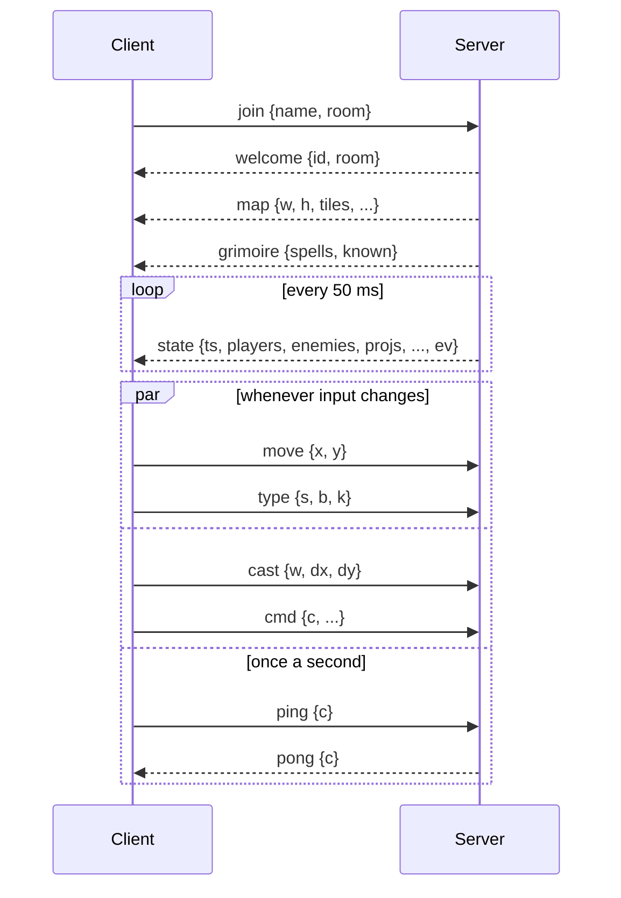
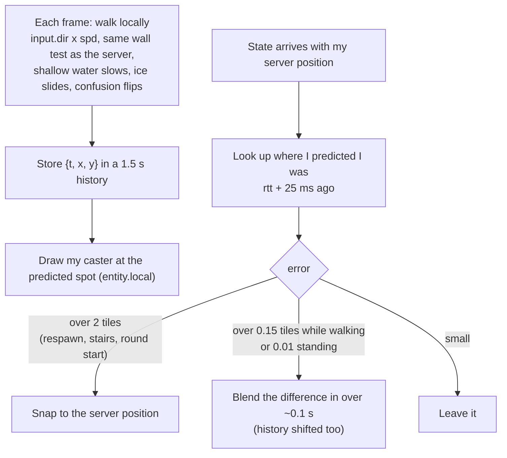

# Network protocol

All game traffic is JSON text over one WebSocket at `ws(s)://<host>/ws` (see `server/GameServer.js` and
`public/js/network.js`). Every message is an object with a type in `t`. The server ignores anything it cannot
parse or does not recognise, and validates every field it uses.

There is one HTTP endpoint besides the static files: `GET /api/saves` returns the saved lobbies for the start
screen, `[{ room, deepest, players: ["Ann (floor 4)", "Bob"], savedAt }]`.

## Client → server

| `t` | Fields | When | Server side |
| --- | --- | --- | --- |
| `join` | `name` (string, cut to 12 chars), `room` (lowercased, `[a-z0-9-]`, max 20, default `lobby`) | Once, right after the socket opens | `GameServer.roomFor(room)`, then `Room.addPlayer`. Answers `full` and closes if the room has 4 casters (2 in the arena). Ignored after the first |
| `ping` | `c` (client `performance.now()`) | Every second | Echoed as `pong` with the same `c`. Works before `join` too |
| `move` | `x`, `y` (unit direction, each clamped to -1..1; `0,0` = stop) | Only when the walking direction changes | `Player.setMoveInput` |
| `type` | `s` finished letters (A-Z, an optional leading `*` rune, max 14), `b` Morse of the letter in progress (`.`/`-`, max 5), `k` key held | On every change of the Morse box | `Player.setTyping`; shown to others as `ty` in the player snapshot; makes noise on silent floors |
| `cast` | `w` word, `dx`, `dy` direction (normalised by the server) | A numpad direction or a swipe with letters typed | Clears `typing`, then `Room.cast → Level.cast` (or `DuelRoom.cast`). `w` must be `^[A-Z]{1,maxLetters}$`, or `*` + up to 12 letters for an effect spell |
| `cmd` | `c` command name, plus its arguments | Menus | Shop commands go to `Shop.run`, the rest to the floor's `ItemCommands.run` (see below) |
| `save` | none | Ctrl+S, or leaving from the Esc menu | `Room.saveNow`: everyone gets a `msg` saying who saved |
| `goto` | `to`: `'arena'` or `'surface'` | Walking into the arena gate; "Leave the arena" in the Esc menu | `GameServer.enterArena` / `leaveArena`. On success the socket gets a new `welcome` and `map` for the other room |

### `cmd` commands

| `c` | Arguments | What it does |
| --- | --- | --- |
| `quaff`, `read`, `wield`, `drop`, `destroy` | `i`: pack index (0 = a) | Use, wear or drop a pack item. Reading a spellbook opens a puzzle (`puzzle` reply) |
| `takeoff` | `slot`: equipment slot (`weapon`, `shield`, `ring`, `neck`, `head`, `body`, `cloak`, `feet`) | Back to the pack |
| `pickup` | none | Pick up everything within 0.8 tiles |
| `solve` | `a`: the answer text | Answer the open spellbook puzzle: `learned` or `puzzleWrong` |
| `unstudy` | none | Close the puzzle |
| `enter` | `kind`: `'shop'` or `'home'` | Standing in that door: reply `store` |
| `buy` | `ref`: a stock ref, or `u:<itemId>` for a resold item | Buy from the shop |
| `sell` | `i`: pack index | Sell for a third of the price |
| `stash` / `take` | `i`: pack / house index | Move between your pack and your house |

Every shop command checks that the caster still stands in the right door (`Town.doorNear`); if not, the reply is
`{ t: 'store', kind: null }` and the client closes the screen.

## Server → client

| `t` | Fields | When |
| --- | --- | --- |
| `welcome` | `id` (your player id), `room`, `duel` (true in the arena) | On join, and again on every `goto` (new room, same socket). The client resets its spell, menus and walking |
| `full` | `max` | The room is full; the socket is closed |
| `map` | see [below](#map) | Entering a floor, after a wipe, when a zoo pen opens |
| `state` | see [below](#state) | Every tick (20/s) to every caster on the floor |
| `msg` | `text` | Angband-style message line for one player (`Player.tell`) |
| `grimoire` | `spells` (the whole catalog), `known` (spell ids) | On join and whenever what you know changes (`Grimoire.dirty`) |
| `puzzle` | `id` (item id, or `null` to close), `title`, `kind`, `lines`, `code`, `school` | Reading a spellbook |
| `puzzleWrong` | `tries`, `text` | A wrong answer |
| `learned` | `id`, `word`, `text` | A right answer: the spell is learned and the book is gone |
| `store` | `kind` (`'shop'`, `'home'` or `null`), `name`, `gold`, and `rows` (shop) or `items` + `size` (house) | After `enter` and after every shop command |
| `drop` | none | Duel: SILEO or a ghost made you drop the spell you were typing |
| `scramble` | none | Duel: MISCEO shuffles the letters you typed (done on the client) |
| `pong` | `c` | Reply to `ping`; the client turns it into `Network.rtt` |

### `map`

Built by `Dungeon.toMessage(floor, pool, extra)`:

| Field | Meaning |
| --- | --- |
| `w`, `h` | Size in tiles (48 x 48 for a dungeon floor, 60 x 36 for the town, 30 x 11 for the arena) |
| `tiles` | One base-36 character per tile, row by row (`'0'` wall, `'1'` floor, ... `'a'` = 10). Codes are `TILE` in `server/Dungeon.js`; the client lists them in `public/js/world.js` |
| `floor` | 0 = the surface |
| `stairs`, `up` | Tile of the stairs down and up (`up` is `null` on the surface) |
| `pool` | Letters in use on this floor (the cheat sheet) |
| `hit` | `HITBOX` from `config.js`, so the client draws hitboxes the same size the server uses |
| `town`, `doors`, `signs`, `lamps` | Surface only (`Town.toMessage`): door tiles with their `kind` (`home`, `shop`, `arena`), zoo signs, lamp posts |
| `duel`, `platform` | Arena only |
| `biome`, `biomeName`, `mods`, `envFixed` | Dungeon floors only (`Environment.mapExtra`): biome id, the floor's curses and blessings `[{ id, name, kind, desc }]`, fixed hazards (`wells`, `portals`, `vents`, `blades`, `pistons`, `rotors`) |

Tiles that change during play (ice freezing, vines growing, a riddle door opening) are sent as a `tile` event
(`{ t: 'tile', n: index, v: code }`) inside `state.ev` instead of a new map.

### `state`

One JSON string per floor per tick, built once in `Level.broadcastState` and shared by every caster on the floor.
Only two parts differ per player: `travel` (your own scroll countdown) and `ev` (events), which are spliced onto
the end of the shared string.

| Field | Meaning |
| --- | --- |
| `ts` | Server time (`Date.now()`) of this tick; used for interpolation |
| `floor`, `stairsOpen`, `maxDepth` | Floor info |
| `msg` | Banner text while it lasts, else `null` |
| `slow` | Seconds of Scroll of Slow Time left |
| `players` | Casters on this floor (see below) |
| `elsewhere` | Teammates on other floors: `[{ id, name, color, lv, floor, dead }]` (party panel) |
| `enemies`, `chests`, `items`, `critters`, `projs`, `minions` | Entity snapshots (see below) |
| `magic` | Effect spells on the floor, or `null`: `z` zones `[{ id, k, x, y, r, c, pid, t, tiles? }]`, `mk` marks (warnings) `[{ k, x, y, x2?, y2?, r, f }]` where `f` is 0..1 progress, `w` rune-wall tile indexes, `pt` portals `[{ x, y, x2, y2, c, t }]` |
| `env` | The biome's moving parts, or `null`: `w` closed machinery tiles, `h` crumbled bridge holes, `cr` crumbling tiles, `hot` / `warm` vents, `up` blades up, `warn` tiles about to move, `slow` slowed machinery, `wind` `[x, y]`, `bliz` blizzard, `ch` challenge `{ k, left, t }` |
| `duel` | Arena only: `{ phase, round, need, winner, count }` |
| `travel` | Only for the caster reading a travel scroll: `{ to, secs }` |
| `ev` | This tick's events (see [events](#events)) |

**Player** (`Player.snapshot`): `id x y name color hp maxHp dead spd lv xp xpNext hurt respawn kills blocks hidden
gold swift ward frozen`, `ty` (`{ s, b, k }` while typing and not concealed), `mana maxMana cd clone` (from the
grimoire), `st` (status list, e.g. `lit`, `confuse`, `mirror`), `conc` (concealed), `stats` (`armor cut speed luck
letters haste reach stagger echo wordHeal blocks fx`), `pack` and `equip` (items as `items.toClient`). In the arena
also `side`, `wins` and `still` (true during the countdown).

**Enemy** (`Enemy.snapshot`): `id x y type word p` (letters already removed) `flash wrong awake stun burn st?`, plus
whatever its `label()` adds: `show` (what to display instead of the word, e.g. `???`), `rev`, `morse`, `tag` +
`tagColor`, `ward`, `open`, `sand`, `extra`, `disguise`, `faded`, `sub`, `dark`, `zz` (asleep on a silent floor)...
Bosses add `boss name hint guard phase phases`; the Bellwraith adds `shield chant open morse`.

> The full `word` is always sent, even when `show` hides it. Hidden names are a rule the client respects, not a
> secret; a modified client could read them. That is fine for a co-op game among friends.

**Spell** (`Spell.snapshot`): `id x y o` (`'p'` player, `'e'` enemy) `l` (letters). Player spells add `c` (colour)
and `pid`; rune orbs add `rn` (effect spell id). Ink letters in the library arrive as `l: '?'` until a caster is close.

**Chest**: `id x y word p flash wrong open`. **Critter**: `id x y kind word p flash wrong happy` (+ `tier` for the
dummy). **FloorItem**: `id x y kind type slot name lvl color h?` (`h` = hidden spellbook). **Minion**: `id x y k c
pid t`, plus `word p flash` when it carries a word.

### Events

Events are one-shot things the client should show or play: `{ t, ...fields }`, most with a position `x, y` in
tiles. The server emits them with `level.emit()` during a tick; `public/js/effects.js` has one `case` per type.
Some carry `id` (whose event it was) so the client can treat its own differently.

| Area | Event types |
| --- | --- |
| Casting and blocking | `cast` `block` `hit` `wrong` `kill` `fizzle` `chip` `chain` `thunder` `cloak` `sblock` `reflect` |
| Casters | `hurt` `down` `revive` `regen` `xp` `levelup` `gold` `ward` `pelt` `pearl` `use` `pickup` `tele` `travel` `stairs` `chest` `resist` |
| Enemies | `ecast` `stun` `rouse` `heard` `freeze` `burn` |
| Rare enemies | `mimic` `split` `steal` `jumble` `mock` `boom` `kblock` `unlock` `regrow` `gdown` `grevive` `hatch` `mreflect` `horn` |
| Bosses | `bshield` `bblock` `bshatter` `bphase` `bossdown` `graves` `gopen` `gblock` `hcut` `hgrow` `slam` `echo` `eshatter` `eshuffle` `reveal` `gust` `gears` `crush` |
| Effect spells | `rcast` `rfizzle` `rland` `summon` `unsummon` `soak` `eat` `spit` `web` `boo` `breath` `status` `buff` `quake` `meteor` `nova` `beam` `spike` `zap` `shock` `collapse` `raise` `crumble` `yank` `phase` `swap` `mirror` `vanish` `unveil` `drain` `portalopen` `portal` `learn` |
| Biomes | `tile` `erupt` `envhit` `creak` `fallaway` `fall` `bounce` `melt` `sprout` `cut` `ignite` `snuff` `dooropen` `shrine` `trial` `trialwin` `trialfail` `dive` `surface` `swoop` |
| Surface | `feed` `dummy` `wish` |
| Duel | `duelgo` `duelwin` |

Two events change client state, not just effects: `tile` (patches the map) and `phase` with your own `id` (PERMEO:
prediction snaps straight to the new position instead of sliding through the wall).

## Back-pressure

`Player.sendState` checks `ws.bufferedAmount`. If more than 64 kB are still waiting on a socket (a slow phone, a
Wi-Fi hiccup), that tick's state is skipped for that player and its events are kept in `missedEvents`, to go out
with the next state that is sent. Old states are never queued: a late state is worse than none, but a missed hit
sound or level-up would be noticed. Sockets also have Nagle's algorithm off (`setNoDelay`).

## Prediction: your own caster

`public/js/prediction.js`. Without it, every step would wait for a round trip plus up to one tick.

Prediction turns off (the caster follows the server) while dead, while `still` (duel countdown) or when `spd` is 0
(frozen, rooted). The constants it shares with the server (`RADIUS`, tile codes, `SHALLOW_SPEED`, `ICE_GRIP`)
are copied at the top of the file: change both sides together.

## Interpolation: everything else

`public/js/world.js` and `Entity.serverPositionAt` in `public/js/entities.js`.

- `World.clock` estimates `performance.now() − server ts`, keeping the offset of the fastest arrivals (it drops
  at once to a smaller offset and drifts up slowly), so network jitter does not shake the timeline.
- Each entity keeps its last 12 `{ t, x, y }` samples.
- Every frame, other casters, enemies, spells and summons are drawn at `serverNow − 100 ms` (two ticks), sliding
  between the two samples around that moment. A jump of more than 3 tiles between samples is a teleport and is
  not slid across.
- Hitboxes (B) are drawn where the server has the entity: for others that is where they are drawn; for your own
  caster it is the server position "now", slightly behind your predicted wizard.

## Ping

The client sends `ping` every second; `rtt` is smoothed (`rtt += (sample − rtt) × 0.2`) and shown next to the room
name. Prediction uses it to find the matching past position.

## Adding a message

See [How to extend it](how-to.md#add-a-network-message).
